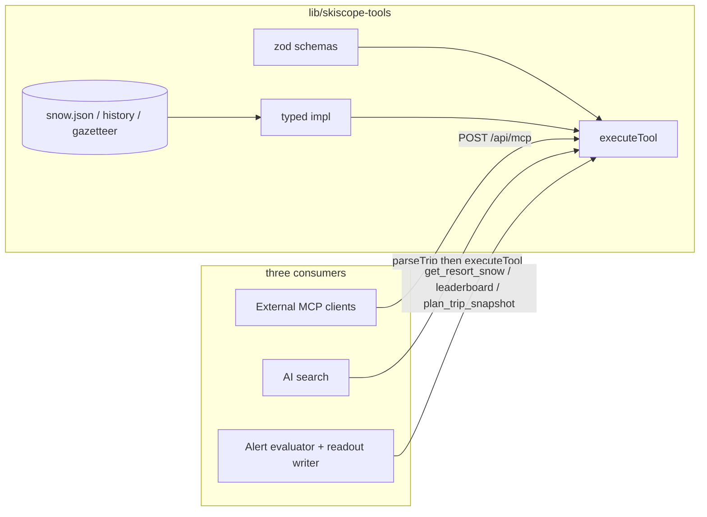

# SkiScope agent harness

SkiScope is **headless**. One typed data layer. Three consumers. Nobody except `lib/skiscope-tools` reads `snow.json`.



| Consumer | Entry | What it does |
|---|---|---|
| External agents | `POST /api/mcp` Streamable HTTP | Claude / Cursor / any MCP client. `tools/list` + `tools/call`. JSON + short text, units in/cm, timestamp + attribution. **No subscriber data.** |
| On-site search | `POST /api/search` + `/api/agent` | Deterministic `parseTripSentence` first. Optional LLM refine when Gateway auth exists. Results are `get_leaderboard` / `get_resort_snow` / `plan_trip_snapshot`. |
| Internal agents | `lib/evaluateAlerts.js` + `lib/readout.js` | Evaluator decides *whether* to fire (threshold, trip cadence, quiet hours). Readout writer is a `ToolLoopAgent` that gathers facts through the same tools, then writes friend-style commentary. Number-grounding validator; deterministic template if Gateway is down. |

## Shared tools

`lib/skiscope-tools/{schemas,impl,catalog,index}.js`

| Tool | Returns |
|---|---|
| `search_resorts` | Fuzzy name / region / pass hits + last 72h / next 7d |
| `list_regions` | Gazetteer (Japan, California, Alps, Rockies, …) |
| `get_leaderboard` | Ranked board (`past72` / `next7` / `dump` / `std` / `vsavg`) |
| `get_resort_snow` | Headline = **actual last 72h**. Forecast is a separate field. Never a combined dump as fallen snow. |
| `get_resort_forecast` | Daily next-N days |
| `get_storm_status` | Quiet / Building / Active / Peaking / Winding down |
| `get_snow_history` | 24h / 72h / storm / season-to-date vs last-five same date |
| `compare_resorts` | Side-by-side, max 8 ids |
| `plan_trip_snapshot` | Snow + forecast + storm + history for a trip window |

Every result is `{ ok, data, text, meta: { generatedAt, source, attribution, units } }`.

`makeAiTools(catalog)` wraps the same `executeTool` for the AI SDK (`ToolLoopAgent` / `generateText`). MCP and the readout agent share that map.

## Files

| File | Role |
|---|---|
| `lib/skiscope-tools/*` | Only place that reads `public/data/snow.json` for these consumers |
| `lib/mcp.js` + `api/mcp.js` | MCP Streamable HTTP |
| `api/data.js` | Public JSON (`?tool=get_leaderboard&region=japan`) |
| `lib/searchQuery.js` + `api/search.js` | Intent → tool call, cache, rate limit |
| `lib/agent/parseTrip.js` | Deterministic intent (`type`: region / country / state / resort / trip / ranking / compare) |
| `lib/agent/tools.js` | Shared snow tools + trip extras (flights, live weather) |
| `lib/evaluateAlerts.js` | Resort storm / region leaderboard / trip T-14…T-0. Facts via `executeTool`. |
| `lib/readout.js` | `gatherFacts` → tools; `writeReadout` LLM or template; `validateReadout` |
| `lib/subscriptions.js` | `resort` / `region` / `trip`, migrate, consolidate, cadence |
| `evals/*.mjs` | Parser, tools, MCP, intent, subscriptions, readout, weather |

The trip-planning extras in `lib/agent/tools.js` (`get_weather`, `build_trip_links`, watchlist actions) are **not** snow facts. They do not replace the shared layer.

## Deterministic vs LLM

| | Deterministic | LLM |
|---|---|---|
| When | Always. Only path if Gateway auth is missing. | `AI_GATEWAY_API_KEY` **or** `VERCEL_OIDC_TOKEN`. |
| Search | `parseTripSentence` → `executeTool` | Same parse, then `generateText` may refine intent (capped tokens). Failure keeps the parser. |
| Readout | `deterministicReadout` template | `ToolLoopAgent` (≤3 steps) then number-grounding. Invented numbers → template. |
| Needs a key in the repo? | No | No. Do not commit a key. |

bbusch team has no card on the AI Gateway today. Calls fail. Search, MCP, alerts, and emails still work. Log: `gateway unavailable, deterministic template`.

Optional: `AI_GATEWAY_MODEL` (default `openai/gpt-5.4-mini`).

## MCP install

```
claude mcp add --transport http skiscope https://skiscope.vercel.app/api/mcp
```

See [mcp.md](mcp.md).

## Evals

```
npm run eval                 # parser + tools + MCP + alerts + readout + …
RUN_LLM=1 npm run eval       # also tries 3 LLM cases; does not fail the suite
```

Today is pinned in `evals/cases.json` (`2026-10-24`).
